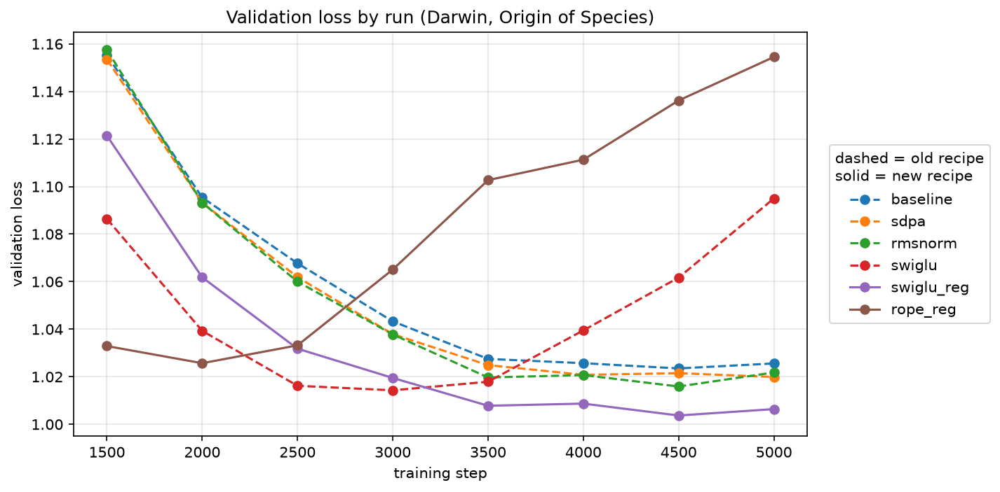

# gptlab

A small GPT language model written from scratch in PyTorch and trained on Charles Darwin's *On the Origin of Species* (6th edition). It started as a re-implementation of Andrej Karpathy's "Let's build GPT" tutorial and was then turned into a packaged project (`uv`, tests, CLI) and upgraded one component at a time, with each change measured against the same baseline.

The point of the project is the **experiment log**: every upgrade is a switchable flag, every run writes a CSV log, and the results below include the cases where an upgrade did *not* help.



*Dashed = original training recipe, solid = improved recipe (see [Training recipe](#training-recipe)).*

## Results

Dataset: *Origin of Species*, 6th edition (1,185,083 characters, vocabulary of 98 characters), 90/10 train/validation split. Model: 6 layers, 6 heads, 384-dim embeddings, 256-character context, about 10.8M parameters. 5,000 steps, batch size 64, one run per row.

| Run | What changed | Params | Best val loss (step) | Bits/char | Val at step 5000 |
|---|---|---|---|---|---|
| `baseline` | manual attention, LayerNorm, ReLU MLP, learned positions | 10.81M | 1.0235 (4500) | 1.477 | 1.0256 |
| `sdpa` | + fused attention (`F.scaled_dot_product_attention`) | 10.81M | 1.0199 (5000) | 1.471 | 1.0199 |
| `rmsnorm` | + RMSNorm | 10.81M | 1.0159 (4500) | 1.466 | 1.0218 |
| `swiglu` | + SwiGLU MLP | 10.80M | 1.0143 (3000) | 1.463 | 1.0950 |
| `swiglu_reg` | + improved training recipe | 10.80M | **1.0037** (4500) | **1.448** | **1.0064** |
| `rope_reg` | + RoPE instead of learned positions | 10.70M | 1.0257 (2000) | 1.480 | 1.1545 |

Rows are cumulative: each run adds one change to the row above it (`rope_reg` is compared against `swiglu_reg`, since both use the improved recipe). Run-to-run noise is roughly ±0.004 in validation loss, estimated from step-to-step fluctuation within a run, so differences smaller than about 0.01 should be read as ties.

### Other measurements

| Measurement | Result |
|---|---|
| Training throughput, manual vs. fused attention | about 1.9× faster with fused attention (average over each run; 1.98× in the first, coolest interval) |
| Generation with KV cache, CPU | 84.8 → 289.1 tokens/s (**3.4×**) |
| Generation with KV cache, GPU (RTX 4050 Laptop) | 191.5 → 176.7 tokens/s (**0.9×**, no benefit) |

### What the results say

- **Fused attention:** same quality, roughly twice the training speed. The speed numbers come from a laptop GPU that throttled during runs, so treat the ratio as approximate.
- **RMSNorm:** a tie with LayerNorm (best val 0.004 lower, final val 0.002 higher). It is a simplification, not an improvement, at this scale.
- **SwiGLU:** learns much faster per step at the same parameter count (val 1.016 at step 2500, where the RMSNorm run was at 1.060). Without regularization it then overfits badly (val rises to 1.095 while train falls to 0.57).
- **Training recipe:** removes the overfitting and gives the best result (best 1.0037, and the final step is almost as good at 1.0064).
- **RoPE:** the fastest early learner (val 1.033 at step 1500) but the worst overfitter, and it finished behind SwiGLU with learned positions (1.0257 vs 1.0037). The 1.2M-character dataset is the bottleneck: every configuration bottoms out near 1.00 to 1.03, so architecture changes mostly change *how fast* the model reaches that floor. RoPE's main advantages (position generalization, longer contexts) are not tested by a fixed 256-character window.
- **KV cache:** correct (tested against the full forward pass), 3.4× faster on CPU, but no gain on GPU. At batch size 1 a 10M-parameter model is limited by per-step kernel-launch overhead, not arithmetic.

## What's implemented

Everything is written by hand in [`src/gptlab/model.py`](src/gptlab/model.py), with each variant selectable by a flag:

| Flag | Options | Notes |
|---|---|---|
| `--attn` | `manual`, `sdpa` | `manual` is per-head attention with an explicit mask; `sdpa` uses a fused kernel for all heads at once |
| `--norm` | `layernorm`, `rmsnorm` | RMSNorm skips mean-centering and the bias |
| `--mlp` | `relu`, `swiglu` | SwiGLU hidden width is 2/3 of 4×384 = 1024, so parameter count matches the ReLU MLP |
| `--pos` | `learned`, `rope` | RoPE rotates queries and keys by position-dependent angles; requires `--attn sdpa` |

Also included:

- **KV cache** for generation (`sdpa` attention only), working with both learned and rotary positions. When the 256-character window fills, the cache is rebuilt from the newest 128 characters, so output past 256 characters is not bit-identical to the uncached sliding window. Up to 256 characters it is identical (tested).
- **Training:** AdamW, linear warmup plus cosine decay, weight decay, bf16 autocast, best-checkpoint saving (the checkpoint stores the model config and vocabulary, so generation does not need the dataset), and a CSV log with train loss, val loss and tokens/sec.
- **Generation:** temperature and top-k sampling.
- **Tests:** 10 `pytest` tests covering RMSNorm against PyTorch's reference, SwiGLU shape and parameter parity, RoPE properties (length preservation, attention scores depend only on relative distance), and KV-cache correctness.

## Training recipe

The first four runs used a plain setup: AdamW with default weight decay (0.01), constant learning rate 3e-4, full fp32. From `swiglu_reg` onward the recipe is:

- 200 steps of linear warmup, then cosine decay down to 10% of the peak learning rate
- weight decay 0.1
- bf16 autocast for the training forward pass

These three changes were made together, so the improvement from `swiglu` to `swiglu_reg` is **not attributed to any one of them**. The current `train.py` always uses the new recipe, so the first four rows can only be reproduced from earlier commits (`git log`).

## Setup

Requires Python 3.12 and [uv](https://docs.astral.sh/uv/). A CUDA GPU is strongly recommended (the runs above took roughly 15 to 45 minutes each on an RTX 4050 Laptop GPU).

```bash
git clone https://github.com/Nooby-Sandwich/gptlab.git
cd gptlab
uv sync
```

On Windows, `uv` installs the CPU-only PyTorch build by default. `pyproject.toml` points `torch` at a CUDA wheel index; change the index name and URL (for example `cu130`) to match your driver, using the selector at pytorch.org.

### Data

The text is not stored in the repository. Download it from Project Gutenberg (eBook #2009, public domain) and clean it:

```bash
mkdir -p data
curl -L -o data/darwin_raw.txt https://www.gutenberg.org/cache/epub/2009/pg2009.txt
uv run python -m gptlab.prepare_data
```

`prepare_data` strips the Gutenberg license text and cuts the glossary and alphabetical index at the back of the book. This matters: the last 10% of the file is the validation set, and without the cut about half of it would be index entries, which makes the validation loss misleading.

## Usage

```bash
# baseline (manual attention, LayerNorm, ReLU, learned positions)
uv run python -m gptlab.train --run_name baseline

# best configuration
uv run python -m gptlab.train --attn sdpa --norm rmsnorm --mlp swiglu --run_name swiglu_reg

# with RoPE
uv run python -m gptlab.train --attn sdpa --norm rmsnorm --mlp swiglu --pos rope --run_name rope_reg

# any hyperparameter is a flag, e.g. --n_layer 8 --batch_size 32 --max_iters 10000
```

Generate text from a saved checkpoint:

```bash
uv run python -m gptlab.generate --ckpt checkpoints/swiglu_reg.pt \
    --prompt "The struggle for existence" --temperature 0.8 --top_k 40
```

Other commands:

```bash
uv run pytest                                                      # run the tests
uv run python -m gptlab.bench_generate --ckpt checkpoints/rope_reg.pt            # KV cache, GPU
uv run python -m gptlab.bench_generate --ckpt checkpoints/rope_reg.pt --device cpu
uv run python -m gptlab.plot_results                               # rebuild results/val_loss.png
```

Training logs are written to `checkpoints/<run_name>_log.csv` (git-ignored); the logs behind the results above are copied into [`results/`](results/).

### Sample output

From `swiglu_reg` at its best checkpoint, with no prompt:

> tinctively been accumulated from each other in a comparative part of the organisation. It should be double to beconsidered as distinct à lie 301 dominant result gnawson "Virge that such generalis can cannot be, included keepingde by man certain species...

The model has learned Darwin's vocabulary, punctuation and sentence rhythm, but it is a 10.8M-parameter character model trained on one book. The text reads like Darwin and says nothing true.

## Project layout

```
gptlab/
├── pyproject.toml, uv.lock
├── src/gptlab/
│   ├── config.py          # ModelConfig / TrainConfig dataclasses (every field is a CLI flag)
│   ├── tokenizer.py       # character-level tokenizer
│   ├── data.py            # dataset loading and batch sampling
│   ├── model.py           # GPT with switchable attention / norm / MLP / positions, KV cache
│   ├── train.py           # training loop, logging, checkpointing
│   ├── generate.py        # sampling from a checkpoint
│   ├── bench_generate.py  # KV-cache benchmark
│   ├── plot_results.py    # loss-curve plot
│   ├── prepare_data.py    # Gutenberg text -> data/input.txt
│   └── prepare_multi.py   # multi-book dataset builder (not used for the results above)
├── tests/
└── results/               # run logs (CSV) and the loss plot
```

## Limitations

- **Single seed per run.** Differences under about 0.01 validation loss are within noise.
- **No separate test set.** The checkpoint with the best validation loss is selected on the same validation split that is reported, which is slightly optimistic.
- **One small dataset** (about 1.2M characters). All configurations overfit it, which caps what architecture changes can show.
- **The training recipe is bundled and not switchable** (see above).
- **Throughput numbers are noisy.** Runs were on a laptop GPU that throttled; tokens/sec in the logs swings by more than 2× within a run. The 1.9× fused-attention figure is an approximation, and no speed claim is made for RMSNorm, SwiGLU or RoPE.
- **Not yet done:** weight decay is applied to all parameters including norms and embeddings (usual practice excludes them), no gradient clipping, no `torch.compile` (Triton is not available on native Windows).
- **Character-level tokenization**, so the model sees one character at a time.

## Next steps

- Train on several Darwin books (`prepare_multi.py` builds a per-book 90/10 split) to test whether more data lets the architecture differences show up.
- Replace the character tokenizer with a BPE tokenizer written from scratch.
- Make the training recipe switchable, then ablate warmup, weight decay and bf16 separately; run several seeds.
- A small web UI with streaming generation.
- A controlled training-speed benchmark that alternates variants under identical thermal conditions.

## Acknowledgements

Based on Andrej Karpathy's "Let's build GPT: from scratch, in code, spelled out" and the *Neural Networks: Zero to Hero* series. The text is from Project Gutenberg.
